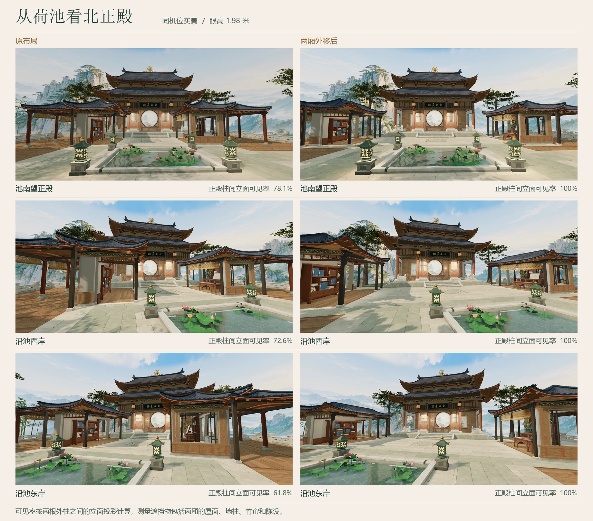
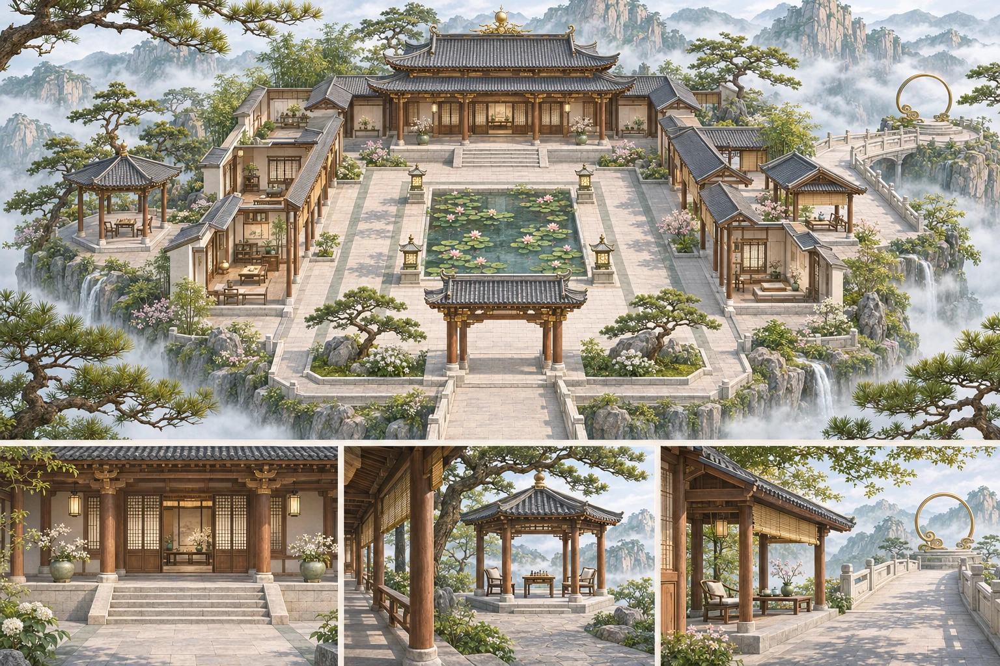
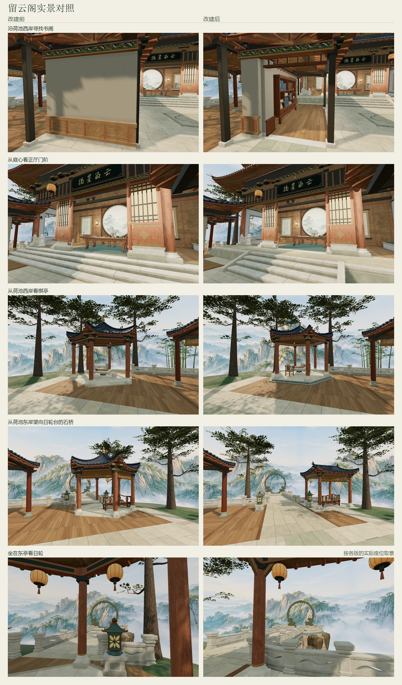
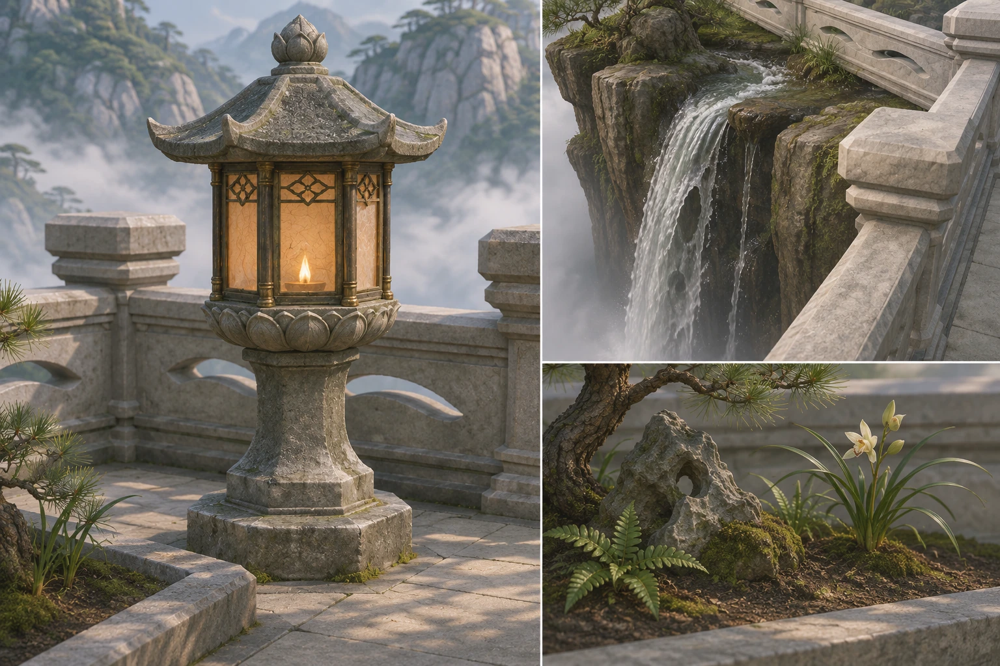
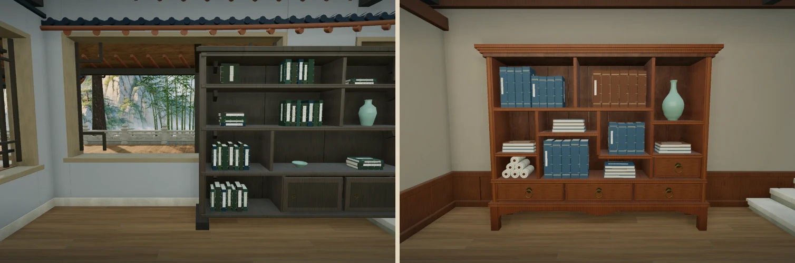

# 云庭 · 分景设计图

九张四视图沿用[云庭总图](../cloud-pass-study.webp)的山门、三面院落和临崖露台。每张从不同角度展开同一处空间，轴测交代进深，平视检查人在屋内能看见什么，侧面和局部用来落定构件的厚度、接缝和材质。

| 游览位置 | 场景四视图 | 建模时对照的细部 |
| --- | --- | --- |
| 候云台 → 渡云桥 → 山门 | [桥头与石拱](gate.webp) | 圆台罗盘嵌石、两孔拱券、桥头铜灯与通向门洞的铺地 |
| 天光水庭 | [庭池与荷花](water.webp) | 压顶石下挑口、四角灯座、水线和留出水面的荷丛 |
| 藏书小阁 | [西书阁](archive.webp) | 两面实墙与木护壁、书柜云牙与铜环、柜脚至石阶的空地 |
| 云庭书斋 | [北正厅](hall.webp) | 翘头书案、屏座、挂轴与墙面之间的进深 |
| 临庭观物 | [东翼工坊](workroom.webp) | 双层工作案、倾斜星图、浑仪的环带和轴托 |
| 松间露台 · 东亭 | [观景坐榻](pavilion.webp) | 如意形靠背、三联坐垫、榻旁的茶案和铜壶色的小茶器 |
| 松间露台 · 西亭 | [六角棋亭](chess.webp) | 十九路棋盘、棋罐和盘沿、束腰石桌与四只鼓墩 |
| 临云长廊 | [竹帘与石供](gallery.webp) | 成卷竹篾与编绳、石槽里的穿孔太湖石和蕨叶 |
| 东云栈 → 日轮台 | [日轮、托座与圆台](sunwheel.webp) | 青铜云托、轮缘铜饰、圆阶上的径向石纹 |

最初的游戏模型给东西两亭配了相同的六角屋面，亭下分别布置坐榻与棋局。后来的改建从来访者在两处停留的原因重新安排了它们。

## 从荷池望见整座正殿

在原设计图上，人的目光越过荷池，可以从左柱脚一直看到右柱脚。旧实景保住了中间的匾和圆屏，书阁和工坊的檐口却截断了正殿两端。由池东绕行时，近侧横披完全藏在厢房后面。恭王府多福轩的实测记载把北面的正殿、殿前月台与东西厢房放进同一个院落考察。留云阁也把月台两肩纳入正殿的轮廓，再从访客站的位置反推庭宽。[原庭院设计图](visitor-plan.webp) · [恭王府博物馆 · 多福轩实测与修缮](https://www.pgm.org.cn/pgm/xsyjou/201205/ca03d36376414aac9b96e9548f827346.shtml)

西书阁与东工坊各外移 4 米，连同外廊、门窗和屋内陈设一起迁移。两厢内柱的轴线间距由 6.40 米增至 14.40 米，正殿两根外柱相距 12.06 米。石庭横向铺至两厢入口。两侧木台在外廊各加宽 2.08 米，到棋亭和东桥前收回，让访客仍可沿原路线绕池、借书、上桥。

下图是在浏览器里以 1.98 米站姿眼高拍的。按两厢及其外廊、帘和陈设遮住的正殿柱间立面面积计算，池南原先可见 78.1%，西岸 72.6%，东岸 61.8%，山门内中线 76.5%。外移后四处均可见完整的柱间立面。两端的下檐角、外柱、纸窗和台基也分别检查过。

## 从山门借书，从茶榭望日轮

改图时先沿访客的来意走三条路，分别去西厢借书，去松下看棋，去东桥看远山。北厅仍然对着山门，两个亭子的形制随各自的用法展开。网师园的月到风来亭依水观月，看松读画轩倚古松，这种把座位和所看之物一起安排的做法用在了东榭。西厢则借用了诺曼所说的可感知线索。人走到分路口，从书脊就能认出藏书处。[苏州市园林和绿化管理局 · 网师园](https://ylj.suzhou.gov.cn/szsylj/sjyc/201905/8aaf3adcfdaf485dada9a071aac3867f.shtml) · [Don Norman · Signifiers, not affordances](https://jnd.org/signifiers-not-affordances/)

| 访客的动作 | 原先遇到的事 | 落到模型里的改动 |
| --- | --- | --- |
| 从正厅出门，或沿侧廊拐进厢房 | 正门到台阶前沿约 34 厘米，两翼侧门的门梃贴着踏步，进东厢迎面碰到工作案 | 四级短梯集中在正中。正门外有 1.57 米深的平地，门内到案前有 1.52 米。两翼门口与侧廊同高，工作案退入室内 |
| 从荷池西岸认出书阁 | 池边分路和西厢近处两个机位都只能看到南墙 | 藏书柜背靠实墙，临池一角开成廊口，池岸石径从这里接到木地面 |
| 从西廊去看棋 | 檐柱迎着来人，四个石凳围住棋盘 | 六角屋架转过半个开间，正开间面向来路。两把木椅隔盘对坐，从廊下就能辨认棋局 |
| 从东榭看日轮，或直接过桥 | 桥头通行与坐榻共用同一个亭下开间 | 四柱茶榭退到桥南，以长椅取景。露天石路直接过桥，坐下、起身各有落脚处 |

下列五组画面都关掉了导览标签。前四组在相同位置、相同视角复拍，最后一组分别坐到两版的实际座位上。茶榭初次移位时，池岸已看得见日轮，座上一根松干仍挡住半圈。把松连同根部移到桥北后，环的两端和中间的山峰才都露了出来。实走时还从池岸进西厢取书，穿侧门去看棋，在东榭坐下再起身，最后从另一侧的门回到正厅。

## 留云阁水庭与廊亭改建

原总图从南桥把远山、荷池和北厅串在同一条线上。新的三视图保留这个取景，在同一张纸上安排了入门后的平视、两翼与正厅的轴测，以及从廊下望亭的眼高视角。西廊用柱列收住视野，到檐口放出一段露天木台。转向东桥时，两列桥栏把视线引向日轮下的远山。这一段游线参考了留园以廊、庭和建筑开口接续水景的做法。从设定图到场景模型的对照方式参考了《古剑奇谭三》的鄢陵。[留园空间布局](https://ylj.suzhou.gov.cn/szsylj/sjyc/201905/b7c0f2058c75498c9ecbacf234e25b08.shtml) · [鄢陵场景设定](https://gjqt3.wangyuan.com/2018/03/13/000003.shtml)

| 实景里的位置 | 旧尺度 | 改建后的尺度 |
| --- | ---: | ---: |
| 西廊太湖石槽到对面柱础的最小净距 | 1.11 米 | 2.21 米 |
| 东西两翼侧门的门框内净宽 | 1.34 米 | 2.08 米 |
| 荷池东西岸，池沿外缘到松池或木石铺地交界 | 2.55 米 | 3.88 米 |
| 东亭至日轮台的桥面全宽，含两侧石栏占地 | 1.90 米 | 3.12 米 |

北厅整体退后 1.60 米，阶前留下连续的横向石庭。石庭中央嵌一枚与石板齐平的海棠花纹。西亭的四只棋凳向棋桌收拢，柱子向外退，直径 88 厘米的圆形碰撞体可以绕棋局走一圈。东亭坐榻靠向南侧，留出正对日轮的穿亭通道。

下图从上到下分别是在山门望向荷池与北厅、从西廊走向棋亭、从东侧露台望向日轮。每行取自同一实机位置，左列为改建前，右列为改建后。

## 迎宾石灯、松下春兰与南桥山泉

从南桥入阁，先能俯看崖边落水，再从两盏石灯之间走进松庭。这三个相邻的局部共用一张近景设计图，定下灯檐的侧影、湿岩出水口的宽度和松根旁花叶的尺度。

两盏门灯从八角石足逐层收至莲瓣灯座。六面的青铜格心均有透孔，格后是暖白的纤维纸，油碟上方隐约透出一点火光。松池用裸土分开石、苔和几丛蕨，两株春兰合计三朵开放、五个花苞，低处的花唇留有斑纹。西廊石槽的蕨叶也长出成对的羽片。[西松池春兰实拍](pine-bed-orchid-detail.webp)

南桥西侧，泉水先流过湿岩之间的浅槽，绕过石唇后分成一道宽水幕和两缕细流。水在下落中加速，薄处能透见后方的岩壁。对照图按石灯、松池和崖瀑排列，上排是旧景，下排是相同站位的改后实景。[同机位浏览器实拍](lantern-cascade-comparison.webp) · [南桥观瀑动图](cliff-spring-motion.webp)

## 早期第一人称实景

留云阁山门加高后的[正面设计图](cloudrest-gate-elevation.webp)以桥上实景为底图，按四根圆柱、石鼓柱础和柱身七字联的比例建模。匾下保留望向后殿圆窗的视线。

西书阁从同一机位朝西看，左图是旧柜与石阶相交的位置，右图可见柜脚下连续的木地板和两面完整的护壁。

