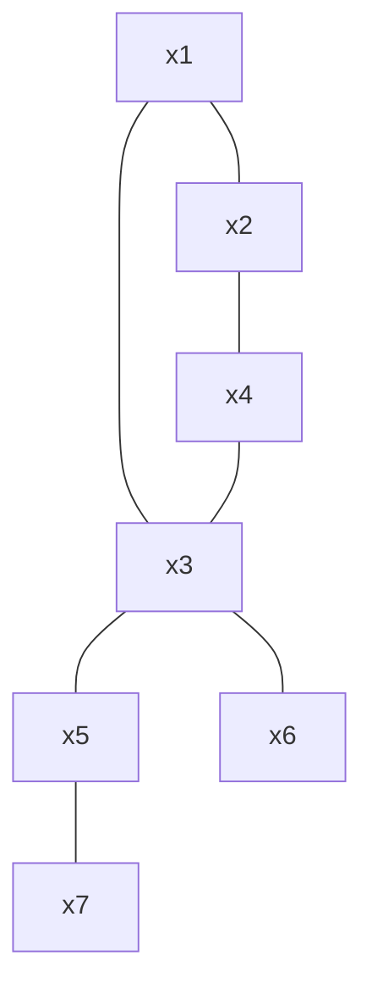
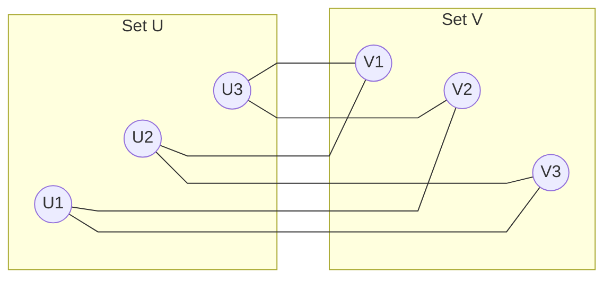
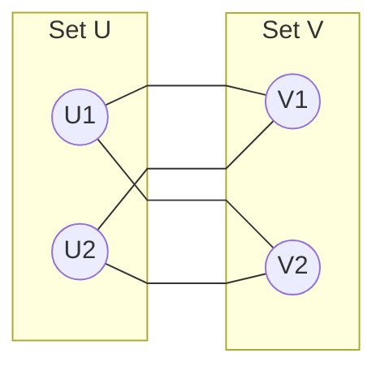
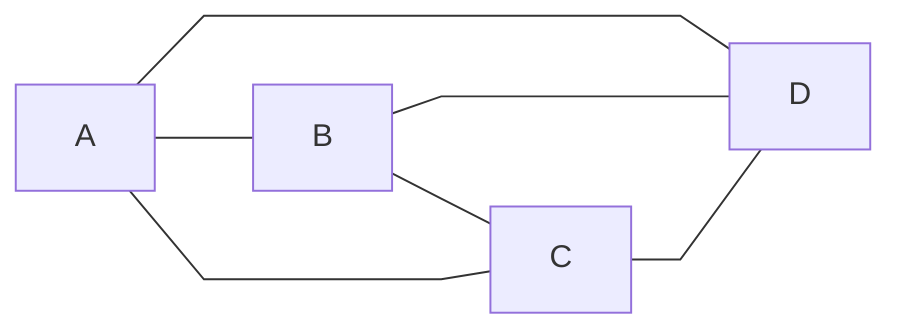

Similar to number theory, it's something that dullards haven't properly studied, and the main content comes from the discrete mathematics course in $ mit $ and $ Gemini $.

# Introduction
Although it seems a bit mysterious, if we want to study the relationship between men and women, graph theory is a good tool.
Which do you think is more numerous, the number of partners men and women have?
According to the survey mentioned in the course, the results from $ US $ are that men are higher than women by $ 73\%$, and according to the mysterious survey from $ BBC $, men are higher than women by $ 233\%$, with each man averaging $ 20 $ and women $ 6 $. ~~ (Why me $ 0 $) ~~
Before studying, let's cover some mathematical basics.
# Definition of a Graph
A graph is a pair of sets $(V,E)$. Here, $ V $ is the set of non-empty vertices (nodes), and $ E $ is the set of pairs of vertices formed from $ V $. A pair of vertices in $ E $ is called an edge.

Vertex $ A,B $ **Adjacent** if there is an edge between them.
An edge is **incident** to its two endpoints.
The **degree** of a vertex is the number of edges incident to it.
A graph is simple if it has no loops or multiple edges. A loop refers to an edge with both endpoints being the same, and multiple edges refer to having more than one edge between two points.

What is the connection between graphs and partners? It's obvious. We can use vertices to represent people, and the existence of an edge to represent whether two people have a partnership. The degree of a person also represents their number of partners.
Then we can define the average number of nodes to characterize the average number of partners.
Let the set of male nodes be $ V_M $, and the set of female nodes be $ V_W $. We define $ A_M,A_W $ to represent the average degree.

$$
A_M=\frac{\sum\limits_{n\in V_M}deg(n)}{|V_M|}=\frac{|E|}{|V_M|}
$$

We assume there are no homosexuals, then the sum of degrees equals the sum of edges. Similarly, we have

$$
A_W=\frac{\sum\limits_{n\in V_W}deg(n)}{|V_W|}=\frac{|E|}{|V_W|}
$$

That is to say, the ratio of the average number of partners for men and women is actually:

$$
\frac{A_M}{A_W}=\frac{|V_W|}{|V_M|}
$$

We haven't made any strange simplifications to solve the problem (unlike the vacuum spherical chicken), this result is exact, so those mysterious surveys... I don't know what they are doing. There are similar surveys that point out that in Boston campuses, the tendency of ethnic minorities to study with non-minorities (because there are few of them).
Unfortunately, that's all the discussion about the relationship between men and women (It seems graph theory cannot help one find a partner?).

# Graph Coloring Problem
Although the actual arrangement of exams cannot give you a clear answer for now, it can be ideally abstracted into a graph theory problem. Let the courses be vertices, and if there are overlapping students, there is an edge. How to schedule exams so that students' exams do not conflict?
### Graph Coloring Problem
Given a graph $ G $ and $ K $ colors, color each node such that adjacent nodes have different colors.
### Chromatic Number of a Graph
The minimum value of the above $ K $. Let it be $\chi(G)$.

The time slots correspond to the colors, and $ G $ represents the courses. So graph coloring becomes the problem of scheduling exams.

### Basic Graph Coloring Algorithm (Greedy)
#### 1. Sorting
Sort the nodes $ V_1,...V_n $
#### 2. Sort the colors
Sort the colors $ C_1,...,C_n $
#### 3. Coloring
Color sequentially, filling the smallest numbered legal color for $ V_i $.
#### Theorem
If the degree of every node does not exceed $ d $, then this algorithm can complete the coloring using at most $ d+1 $ colors.

>[!Proof]
>Proof by induction.
>It is said that many students in $ MIT $ changed $ d $ to $ n $ in the exam to try to induce. It seems indeed very tempting. $ n=0,1 $ is obviously true, and then consider from $ n $ to $ n+1 $, what about it? It's hard to reduce a graph with maximum degree $ n+1 $ to a graph with $ n $.
>A feasible approach is to induct on the number of nodes, which is a relatively common operation in graphs. If the number of nodes is not enough, we can also add edges.
>
>**Inductive Hypothesis**: Assume that for all graphs with $ n = k $ nodes and maximum degree not exceeding $ d $, this algorithm can complete the coloring using no more than $ d+1 $ colors. This is obviously true for $ n=1,2 $.
>
>**Inductive Step** Now consider a graph $ G $ with $ n = k+1 $ nodes. We remove an arbitrary vertex $ v $ and its incident edges from the graph $ G $. The remaining subgraph $ G'$ has $ k $ nodes.
>
>**Applying the Hypothesis** Since the degree of every node in the original graph does not exceed $ d $, after removing $ v $, the maximum degree of the subgraph $ G'$ still does not exceed $ d $. By the **Inductive Hypothesis**, $ G'$ can be legally colored using $ d+1 $ colors.
>
>**Reinserting the Vertex $ v $** Now we put the vertex $ v $ back into the graph. At this point, we need to color $ v $. In the original graph, the degree of $ v $ is $\text{deg}(v) \leq d $. This means that $ v $ has at most $ d $ neighbors. Even if these $ d $ neighbors are colored with $ d $ different colors in the second step, since we have a total of $ d+1 $ colors available, there must be at least one color not used by the neighbors of $ v $. We assign that remaining color to $ v $. At this point, $ v $ has a color different from all its neighbors, and the coloring is still legal.
>
>**Conclusion:** By mathematical induction, for any $ n $, as long as the maximum degree does not exceed $ d $, the greedy algorithm can complete the coloring using at most $ d+1 $ colors. **Q.E.D.**

This gives an upper bound for the greedy approach. In fact, it might do better, for example, a radial graph only needs $ 2 $ colors. The effectiveness of this algorithm is highly dependent on the ordering, for example, consider such a graph:

This can be divided into two sets, and a graph whose edges always connect from one set to the other is called a bipartite graph. You can try it yourself and find that the ordering greatly affects the number of colors needed.

# Matching Algorithm
After the engagement, there comes the more solemn marriage, and marriage is actually a matching problem (
**Definition**: Given a graph $ G=(V,E)$, a matching is a subgraph $ G $ where the degree of every node is $ 1 $. ~~ (Monogamy) ~~
If every node is matched, this matching is called a perfect matching.
Sometimes we encounter weighted graphs, where every edge has its own weight. **Definition**: The **weight** of a matching is the sum of the weights of all its edges. This naturally leads to the **minimum weight perfect matching**.
Sometimes the weights are not symmetric, just as liking someone might not be mutual. $ W_{ij} \neq W_{ji}$ is very common (

For example, U1 and V2 are each other's first choice, but U2 considers V2 as his first choice, and V1 considers U1 as her first choice. ~~So complicated~~ 

**Definition**: If, in the current matching proposal, a pair of members prefer each other more than the person currently assigned to them, then they are an unstable pair. Before everyone reacts, they will secretly leave and discuss discrete mathematics late into the night (

**Definition**: If there are no unstable pairs, then we say it is a stable matching.

If we want it to be stable, we can let U1 and V2 pair up here. Although not everyone is happy, at least it is stable(?)
But reality is often much more complicated, and perhaps a stable matching does not even exist. In the worst-case scenario (mathematically speaking), the relationship might not be a bipartite graph (

According to the order of $ ABC $, they are in order of first choice, and in reverse, they are in order of second choice, and $ D $ is always third choice (
In this case, **no stable matching can exist**.

>[!Proof]
>Using proof by contradiction. Assume a stable matching exists. Without loss of generality, let AD be the matching. Then because C prefers A, and A prefers C, there is an unstable pair.

## Stable Marriage Problem
Suppose there are $ N $ boys and $ N $ girls. Everyone has their own preference ranking. Can we find a stable matching?

Greedy is a simple method, but how effective is it? Trying with some random data shows that it is easy to generate unstable pairs. Not good.

**The Dating Algorithm (TMA)**
Every morning, the girls stand on their balconies, and every boy sings a serenade under the balcony of his favorite girl on his list. In the afternoon, if a girl has at least one suitor, she will choose her favorite one, telling him maybe they will get married and hoping he comes again tomorrow, so as not to seem too frivolous. Then she rejects the other lower-ranked boys, and these poor boys delete this girl from their list. This repeats until every girl has only one suitor. Thus, no girl will be left unmarried, and no boy will be rejected by all girls, and no one will be left at home doing their discrete mathematics homework, and there will be no unstable pairs.

We will prove

- that this process terminates in a finite number of steps; the boys will not sing serenades forever.

- Everyone will get married.

- There will be no unstable pairs.

>[!Proof will end relatively quickly]
>Using proof by contradiction. Assume the termination time is later than $ N^2+1 $ days.
>If it does not terminate, then at least one boy must have crossed out a girl from his list (rejected www). Then after $ N^2+1 $ days, $ N^2+1 $ girls will have been crossed out. But there are only $ N^2 $ girls in total. This is a contradiction.
>Therefore, it must terminate by $ N^2+1 $ at the latest.

>[!Proof that everyone gets married]
>Let $ P=$ "If a girl $ G $ rejects a boy $ B $, then the spouse of $ G $ must not be worse than $ B $'s."
> $ Lemma $ $ 1 $ : $ P $ is an invariant during the process.
> Proof: Initially, no one is rejected, so it is correct. Assume it holds at $ d $. If $ d+1 $ rejects $ B $ at $ G $, then by the process, it is naturally true that $ P $ holds. If $ G $ rejected $ B $ before this, then by the assumption, $ G $ has a better choice on day $ d $ than $ B $, which naturally makes $ P $ true.
>
> Using proof by contradiction
> Assume that at the end, $ B $ is not married, which means he was rejected by everyone. According to $ Lemma $ $ 1 $, this means that all girls have a better choice than $ B $, which means every girl is married, and thus every boy is also married, a contradiction. Therefore, the proposition is true.

>[!Proof that there are no unstable pairs]
>Let $ Bob $ and $ Gail $ be a pair of unmarried man and woman. Below we prove that they are not an unstable pair.
>Case 1: $ Gail $ rejects $ Bob $, which means $ Gail $ is married to a man she considers better than $ Bob $. Then because $ Gail $ prefers her spouse, $ Gail $ and $ Bob $ will not be an unstable pair.
>Case 2: $ Gail $ did not reject $ Bob $, which means $ Bob $ did not sing a serenade for $ Gail $, so $ Bob $ prefers his spouse, so they will not be an unstable pair.
>The above covers all cases, so there will be no unstable pairs.

Let $ S $ be the set of all stable matchings. Since the above $ TMA $ algorithm produces a stable solution, $ S $ is non-empty.

For each person $ P $, define a set $ R $ containing $ S $ all $ P $ possible partners.

**Define** a person's best partner as $ R $ the $ P $ favorite, and worst partner as $ R $ the $ P $ the least favorite. Then we will get two major theorems:

- $ TMA $ Pair every boy with his best partner.

- $ TMA $ Pair every girl with her worst partner.

These two theorems reveal an interesting phenomenon in game theory: **initiative brings optimality.**

>[!Proof that boys get their best partners]
>Assume there is at least one boy who is not paired with his best partner. Let $ B $ be the first among them who is rejected by a (stable) partner in $ R $.
>Let his best partner be $ G $. By the algorithm, $ B $ has been rejected by $ G $, so $ G $ has a partner $ B'$ better than $ B $.
>Then, by assumption, $ B'$ has not been rejected by a stable partner. Thus, either $ G $ is $ B'$'s best partner, or is better than his best partner, i.e.: in any stable matching $ M $ containing $(B, G)$, $ B'$ will prefer $ G $ (compared to $ B'$'s spouse in $ M $).
> $ G $ is $ B $'s stable partner, and $ G $ prefers $ B'$, and $ B'$ also prefers $ G $, so $ G $ and $ B'$ form an unstable pair, a contradiction.
> Thus, no boy is rejected by his best partner.

>[!Proof that girls get their worst partners]
>Suppose a girl gets a stable matching partner $ B'$ than $ TMA $ in $ B $ is worse. Let $ B $ be the partner in that stable matching, $ G'$ by the theorem just proved,$ B $ prefer $ G $and $ G $ also prefer $ B $thus $ m $ match has $ B,G $ this pair of unstable pairs, unstable, contradictory.
>Thus, the girls get their worst partners.