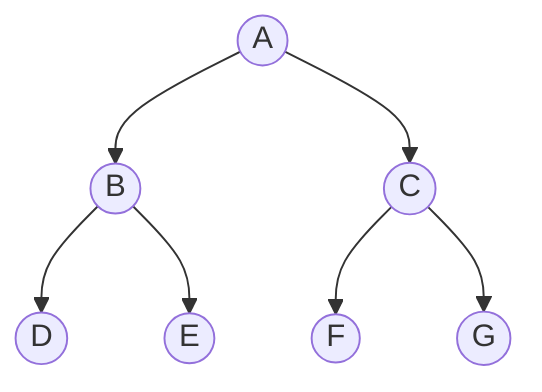
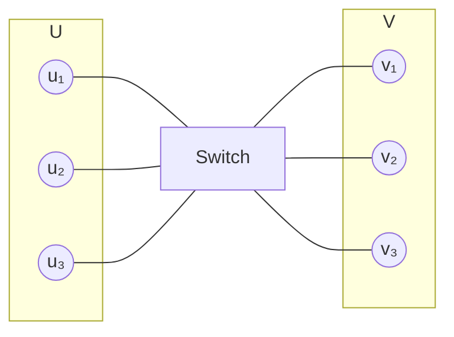
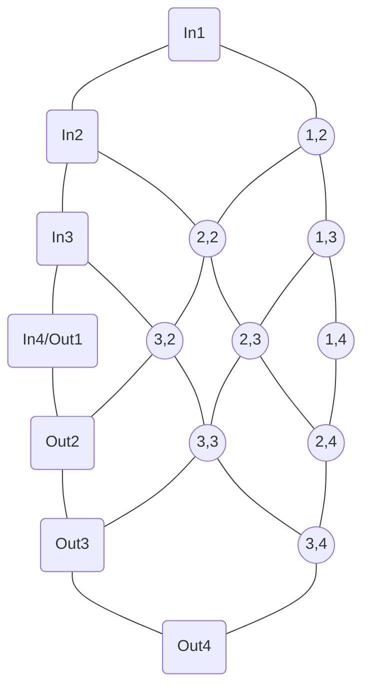
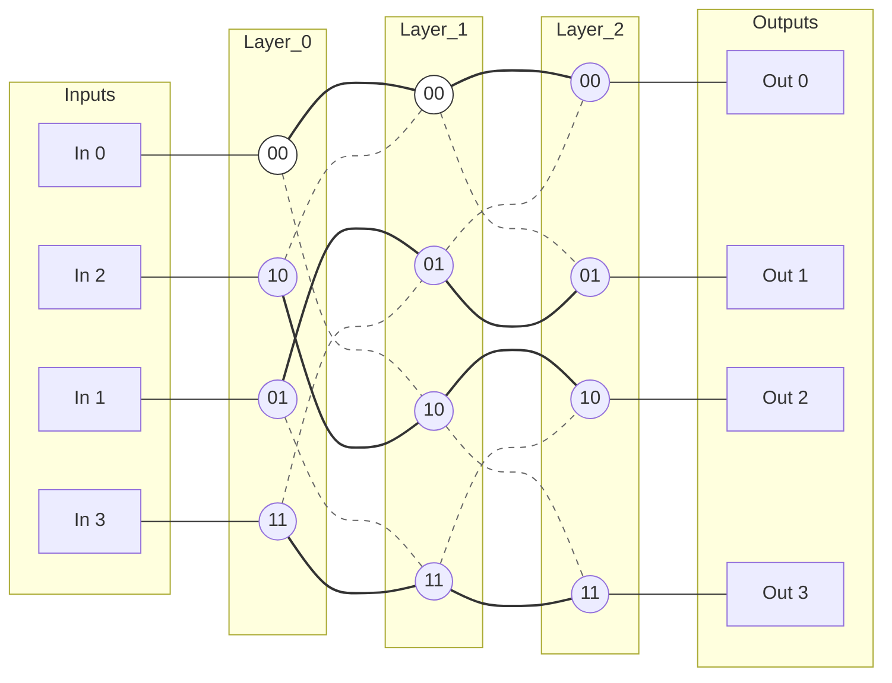
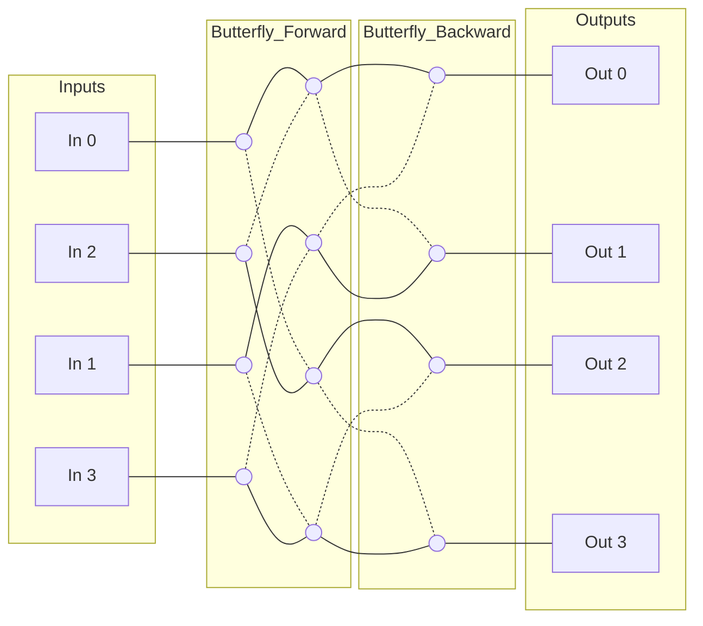

In distributed systems and multi-processor computers, the core problem is how to efficiently connect $ N $ inputs to $ N $ outputs.

### 1. Four Key Metrics for Communication Networks

When designing a network topology $ G $, we examine the following four properties:

- The required number and size of switches
    
- **Degree:** The number of edges emanating from each node (limited by the number of physical interfaces of the hardware, ideally a constant).
    
- **Diameter:** The maximum length of the shortest path from any input to any output (determines the maximum signal transmission delay).
    
- **Congestion:** The maximum number of packets passing through any edge in all possible "one-to-one" communication arrangements (determines the throughput bottleneck of the network).
    
#### Arrangement
A function from $ 1,...,n $ to $ 1,...,n $ that maps $ i $ to $\pi(i)$, $\pi(i)=n(j)$ if and only if $ i=j $.

For $ N $ an input and output, $ i $ the $ path $ is denoted as $ P_{i,\pi(i)}$ **Congestion Degree** : The maximum number of times an edge is traversed among all $ P_{i,\pi(i)}$ edges that pass through. For example, for a binary tree, this value might be $ 1 $(the same as the parent node of the input and output), or it might be $ N $(the node at the very top that all inputs must pass through to reach the output), then its congestion degree is $ N $ .

---

### 2. Types of Structures

#### Binary Tree
The bottom layer consists of inputs and outputs.

- **Metrics:** Diameter $= 2(1+log(N))$, requires $ 2N-1 $ switches.
    
- **Fatal Flaw:** Congestion $= N $.

####  Complete Bipartite Network

Each input is directly connected to every output.

- **Metrics:** Diameter $= 1 $, Congestion $= 1 $.
    
- **Fatal Flaw:** Requires a $ N\times N $ switch.
    

#### B. 2-D Mesh

An array of $ N \times N $.

- **Metrics:** Degree $= 4 $, requires $ N^2 $ $ 2\times 2 $ switches, Congestion $=2 $.
    
- **Drawback:** **Diameter $= 2N $**. 
    

##### Theorem: Congestion = 2

>[!Proof]
>Such a traversal: $ P_{i,\pi(i)}$ is moving from $ row_i $ to $ col_{\pi(i)}$ on the right, and then moving down to the output. For node $(i,\pi(i))$, it can only be reached from the left or from above, so it can only come from $ Ini $ and arrive at $ Out\pi(i)$, thus not exceeding $ 2 $, and clearly there exists an arrangement that achieves $ 2 $.

#### Butterfly Network

To solve the latency problem, we introduce hierarchical recursion. A butterfly network of size $ N=2^k $ is composed of two sub-networks of size $ N/2 $.

- **Structure:** There are $\log N + 1 $ layers, with $ N $ nodes per layer.
    
- **Routing Logic:** Node addresses are binary. At layer $ i $, compare the $ i $-th bit of the target address:
    
    - If it is 0, go to the lower-left sub-network;
        
    - If it is 1, go to the lower-right sub-network.
        
- **Metrics:**
    
    - **Size:** $ N(\log N + 1)$
        
    - **Degree:** 4
        
    - **Diameter:** $ 2+\log N $ (**Huge breakthrough!** With $ 10^6 $ nodes, the diameter is only about 20).
        
    - **Congestion:** $\approx \sqrt{N}$ (Severe "traffic jam" occurs in the middle layer).
        

If the input numbers are represented in binary, then to reach the output, one simply follows this rule: if these $ bit $ two are the same, proceed; otherwise, jump to the previous or next butterfly-shaped small network.

#### Benes Network

Composed of two butterfly networks placed back-to-back, its blocking factor is $ 1 $.

>[!]
>Consider the case of $ N=2^a, a=1,2,3...$. Since removing the first and last columns from the $ Benes $ network and keeping the upper half still results in a $ Benes $ network, induction can be used for the proof.
>For the case of $ a=1 $, it is known to be true by simple enumeration.
>The inductive hypothesis is the proposition, and the case of $ a $ can be decomposed into the case of $ 2 $ networks of $ a-1 $ plus the nodes at the ends. At this point, as long as the way of distributing into the upper and lower sub-networks is done well, the inductive hypothesis can be used to prove it.
>Specifically, we need to make the input end of the sub-network accept only one signal. Since each input end has two arrows pointing to it, we need a strategy such that each input end is left with only one, and similarly for the output.
>Construct a constraint graph, draw the input ends of the original graph, and draw lines between nodes pointing to the same sub-network input end.
>Nodes: $ 0, 1, \dots, N-1 $.
>Edge Type A (Input): Connect the input ends pointing to the same subnet, indicating they must go to different subnets. 
>Edge Type B (Output): If the destination of input $ i $ is $ j $, and the destination of input $ i'$ is $ j'$, and $ j, j'$ belongs to the same output switch, then connect $ i $ and $ i'$.
>In this constraint graph $ G'$, the degree of every node is exactly 2 (one input constraint edge, one output constraint edge).
>

