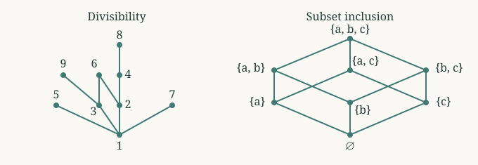

I also thought about making notes similar to a textbook, and I did that last semester, but it was laborious and not very meaningful, so I'd rather do some interesting exploratory records.
## Hasse Diagram

A Hasse diagram is a graph used to describe a partial order relation. Specifically, we first need to define covering:

### Covering

Let $<A,\preceq >$ be a partially ordered set, and $\forall x,y \in A$, if $x\prec y$ and there does not exist $z\in A$ such that $x\prec z \prec y$, then call $y$ covers $x$.

Simply put, it means there is no element that can be inserted between them (

Then a Hasse diagram is a directed graph whose vertices are the elements of the set. If we say that $y$ covers $x$, we draw an edge from $x$ to $y$. For example:

**Example 2.7.1.** Draw the Hasse diagrams for divisibility on $\{1,2,\ldots,9\}$
and for inclusion on the power set of $\{a,b,c\}$.

The Hasse diagram allows us to see the "size" in the partial order relation at a glance. Although it is slightly different from the familiar less than or equal to, this clear structure is quite good.

The elements on the upper side are relatively higher in the partial order chain, and elements on the same level are incomparable. A subset of a partially ordered set where any two elements are incomparable is called an **antichain**, so the elements on one level form one antichain.

If we have a totally ordered set, then the Hasse diagram can be seen as a chain with no branches.

## Hasse Diagram and the Cube

We see the Hasse diagram of the partially ordered set $<P(\{a,b,c\},R_{\subseteq})>$, and it looks a lot like a cube. Is this a coincidence? 

The power set of a set with n elements indeed has $2^n$ elements. At the same time, for three dimensions, we can use the Cartesian product $\{0,1\}^3$ to characterize each power set, and using $0,1$ to represent whether each element appears, this is exactly isomorphic to $P\{a,b,c\}$, which also corresponds to the coordinates of a three-dimensional cube. For any dimension, it should be similar, forming a $n$-dimensional hypercube.

## Hasse Diagram and Combinatorics, Sperner's Theorem

For example, in three dimensions, the elements in each layer are 1331, which is a binomial coefficient.

Of course, this is trivial; the generation of the power set itself is a combination. However, we can learn information about antichains, for example, the longest antichain partitioned by layers. We can guess

$$
\text{Maximum Antichain Size}=\binom{n}{\lfloor n/2\rfloor}
$$

This is the so-called $Sperner$ theorem. But we have not verified its correctness.

### proof

Although the layer partition is quite beautiful, general antichains are not easy to find. Perhaps we need to be indirect. An antichain means that its elements are pairwise incomparable. Then consider a maximal chain in the Boolean lattice going from bottom to top; the elements in the antichain can appear at most once. Therefore, the expected size of the intersection between the antichain and the maximal chain is naturally less than or equal to 1.

Let $A$ be our universal set.

A maximal chain going from bottom to top means that for each step up, a new element is added.

We consider a k-element $A$ subset that is passed through by a maximal chain, which means that the first k subsets of the maximal chain are all contained in this set. For example, if we select $\{2,4\}$ as a subset of $A=\{1,2,3,4\}$, and the maximal chain must pass through the node $\{2,4\}$ in the Boolean lattice, then the first step is either 2 or 4, and the next step completes the remaining one.

In total, we have $n!$ ways to proceed, so the first $k$ elements are determined, and we have $k!(n-k)!$ ways to proceed, which means the probability of passing through is

$$
\frac{k!(n-k)!}{n!}=\frac{1}{\binom{n}{k}}
$$

So, let the intersection of the antichain $Anti$ and a random maximal chain $M$ be $X_M$. The number of elements in this set is less than or equal to 1, so $E(|X_M|)\le 1$. Next, we try to calculate this expectation.

We consider the indicator function, $I_{a}(M),a\in Anti$, which is 1 if $a$ is passed through by $M$, and 0 otherwise. Then

$$
|X_M|=\sum_{a\in Anti} I_a(M)
$$

Thus

$$
E(|X_M|)=E(\sum I_a(M))=\sum E(I_a(M))=\sum p(a\in M)
$$

And using what was mentioned before, that is

$$
E(|X_M|)=\sum_{a\in Anti} \frac{1}{\binom{n}{|a|}}\le 1
$$

This is the so-called **$LYM$ inequality**.

From this, we have

$$
\frac{|Anti|}{\binom{n}{\lfloor n/2 \rfloor}}=\sum_{a\in Anti} \frac{1}{\binom{n}{\lfloor n/2 \rfloor}} \le \sum_{a\in Anti} \frac{1}{\binom{n}{|a|}}\le 1
$$

Rearranging the terms gives

$$
|Anti|\le \binom{n}{\lfloor n/2 \rfloor}
$$

This completes the proof.

It must be said that the proof is a bit elusive (\nUsing the expected intersection of a maximal chain and an antichain to indirectly constrain the size of the antichain.)