## 8.28

乘高铁，跨过长江，我到了杭州。

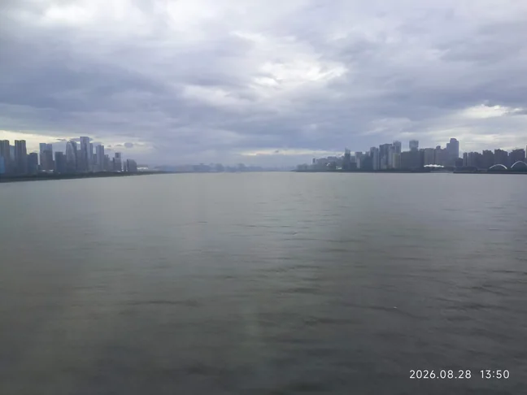

我预定了在西湖附近的青旅

八人间的青旅，相当狭窄，才通人，幸而看上去还算干净，也没什么异味，不过楼里的厕所还是相当恐怖。就我所见，似乎有些常住的人，换算下来，青旅确实还挺便宜，但是环境，我以为有点难以接受，短住一两天，我就有点厌烦了。

青旅位置确实不错，在所谓古街上，白墙黑瓦，倒确是心中对江南的印象。逛着逛着，看到向上的台阶，便沿上。

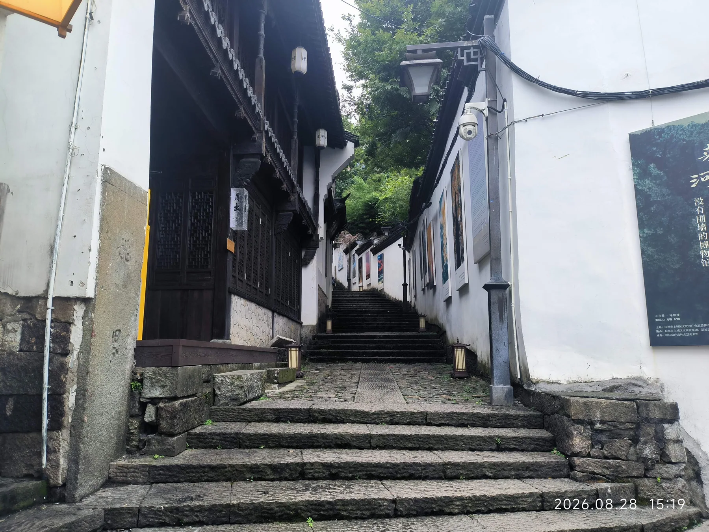

随处回望，处处是风景

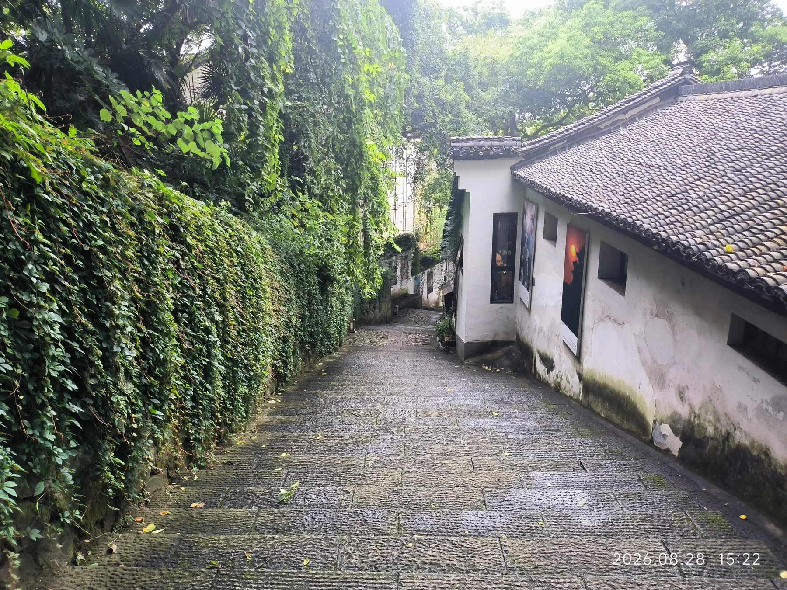

像是番剧里会出现的场景呢。此处人并不多，也很清幽。一路向上，便到了西湖周遭的一处山上。山上，有开的正盛的彼岸花。石蒜之名，听起来美感就少了不少，大约也是为什么人们记得曼珠沙华、彼岸花这样的名字，自内蕴了一种神秘，一种缥缈。

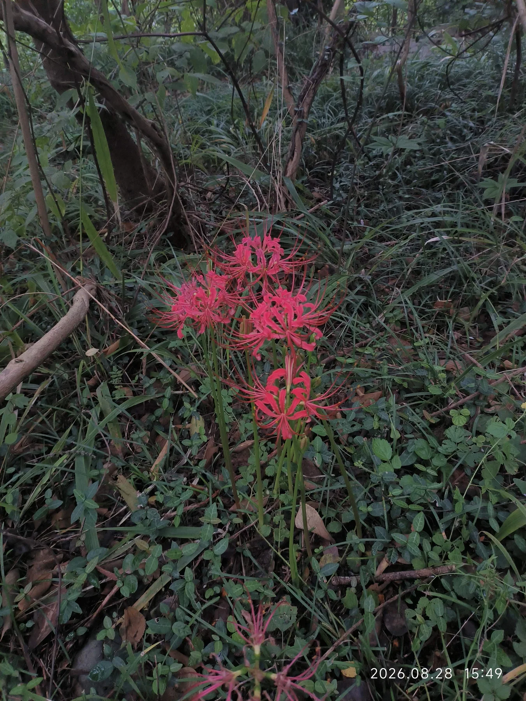

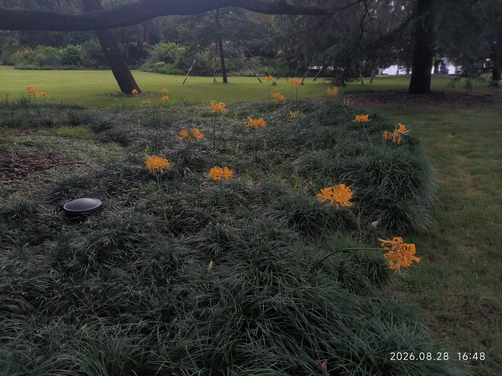

上山途中，道有狗群，面面相觑，各自小心。最后我避其锋芒，目光不离它们下了山，倒有些惊心。山里灵活的狗群，我还真不一定打得过。西湖周遭的山，竟还暗藏杀机。

下了山，还须骑一段路的车，方才到了西湖。或许挑错了路，骑了相当长一段上坡，累的够呛。

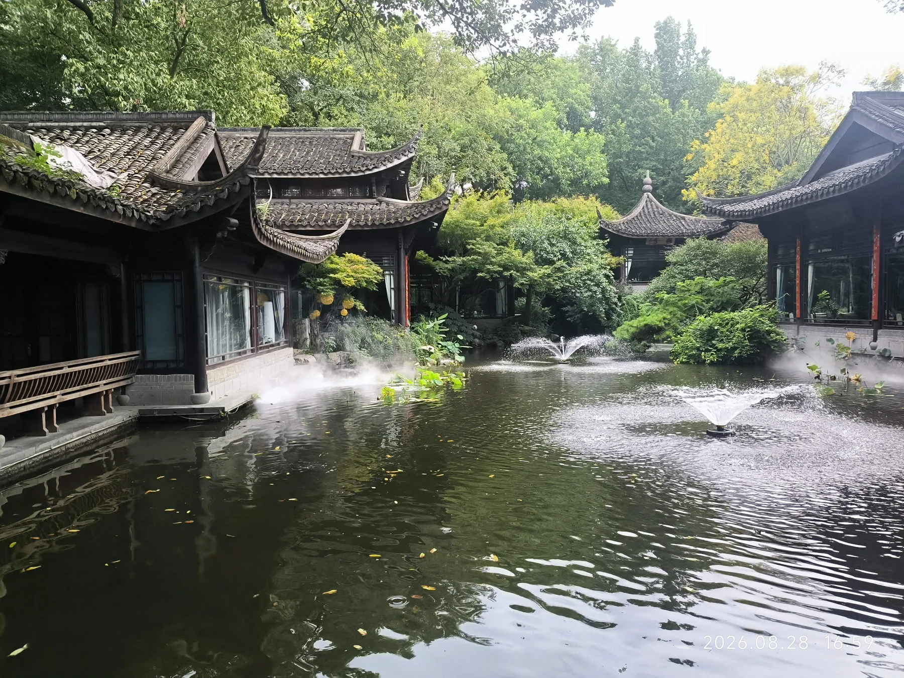

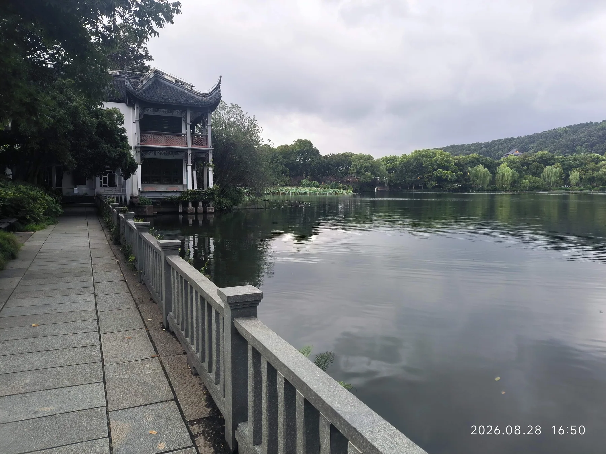

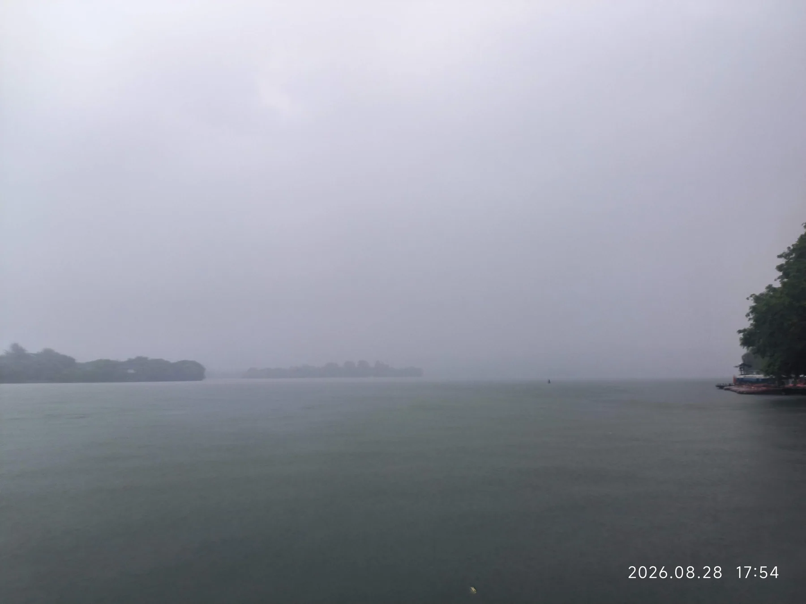

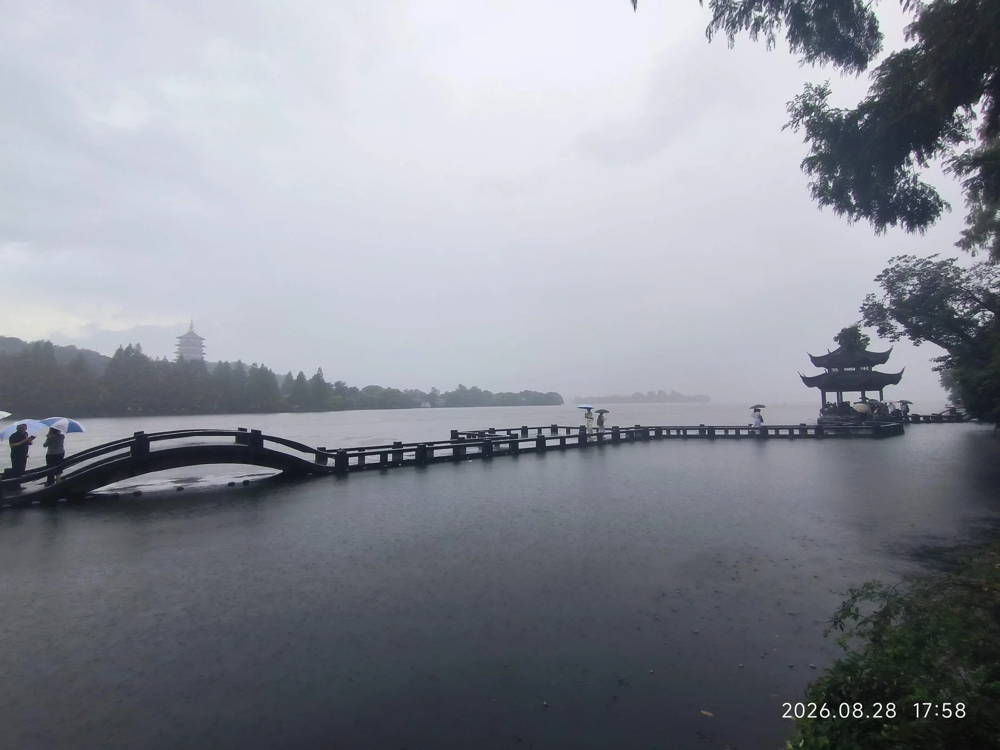

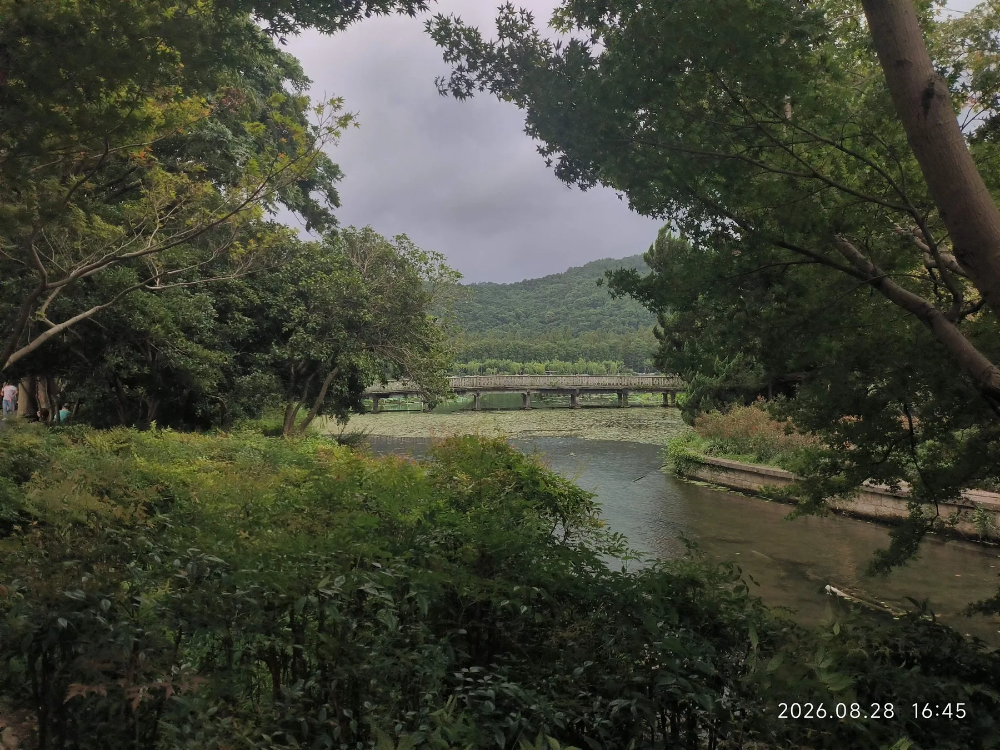

想到古河渚（

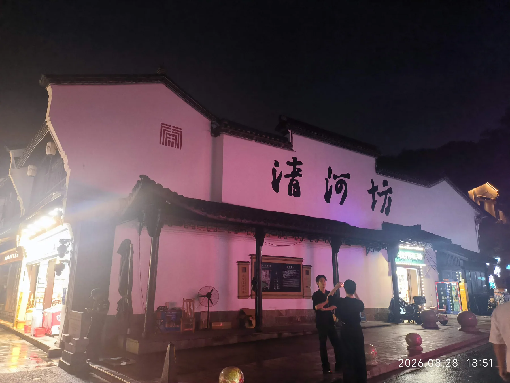

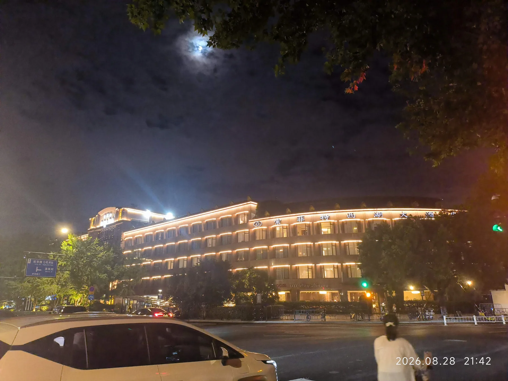

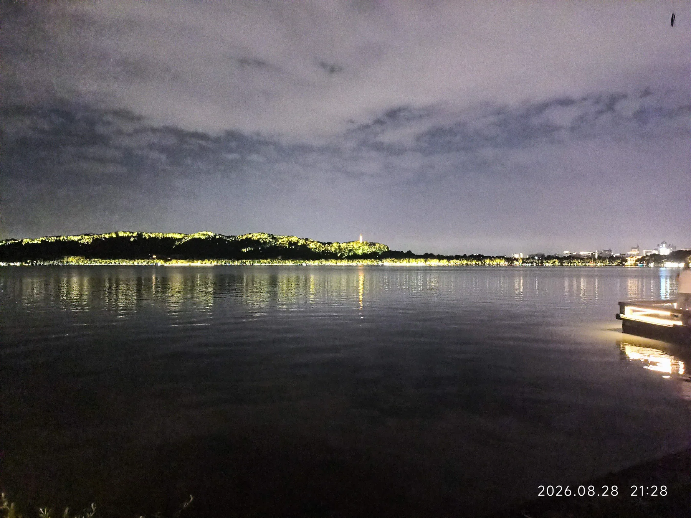
