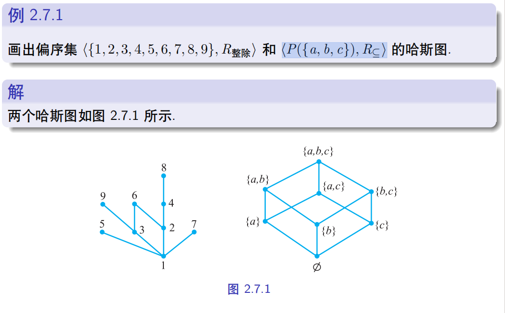

也想过做一个复刻教材类似的Notes，上学期也干过这事，但是一则费力，再则意义不大，未若做一些有趣的探索记录。
## 哈斯图

哈斯图是用于描述偏序关系的图，具体地，我们需要先定义覆盖：

### 覆盖

设 $<A,\preceq >$ 为偏序集，$\forall x,y \in A$ ，如果 $x\prec y$ 且不存在 $z\in A$ 使得 $x\prec z \prec y$ ，那就称 $y$ 覆盖 $x$ 。

简单来说，就是不存在元素能插入其中（

那么哈斯图，就是一个有向图，其顶点是集合元素，设若 $y$ 覆盖 $x$ ，就画出自 $x$ 到 $y$ 的一条边。例如：

哈斯图能让我们一眼看出偏序关系中的“大小”，尽管和熟知的小于等于略有差别，但是这样清晰的结构是相当好的。

在上方的则在偏序链条中相对高位，同一层的元素之间不可比。任意两个元素都不可比的偏序集中的集合被称为**反链**，所以一层元素就是一层反链。

设若是一个全序集，那么可想见哈斯图是一条无分支的链条。

## 哈斯图与立方体

我们看到 $<P(\{a,b,c\},R_{\subseteq})>$ 这个偏序集的哈斯图，它长得很像一个立方体。这是巧合吗？ 

顶点上，n 个元素的集合的幂集确实是 $2^n$ 个。同时，对于三维，我们可以用 $\{0,1\}^3$ 这个笛卡尔积来刻画每个幂集，用 $0,1$ 表征每个元素是否出现，则这恰好同构于 $P\{a,b,c\}$ ，也正对应于一个三维立方体的坐标。对任意维度实际上应该是类似的，构成一个 $n$ 维的超立方体。

## 哈斯图与组合数，Sperner定理

例如三维，层中元素分别为1331，正是组合数。

当然，这是trivial的，幂集的生成本身就是组合。不过我们可以得知关于反链的信息，例如中间的反链是按层划分的最长的反链，我们可以猜想

$$
最长反链大小=\binom{n}{\lfloor n/2\rfloor}
$$

这是所谓 $Sperner$ 定理。但是我们并没有验证其正确性。

### proof

虽然层级划分相当美丽，但是一般的反链并不好找。也许我们需要旁敲侧击，反链意味着其中元素互相不可比，那么考虑哈斯图一条自下而上的链(maximal chain)，则反链中的元素至多出现一次。那么反链与 maximal chain 的交的大小的期望自然小于等于 1。

假定 $A$ 是我们的全集。

一条自下而上的 maximal chain，每向上走一步就相当于加入一个新元素。

我们考虑一个 k 元素 $A$ 子集被 maximal chain经过，也就是说 maximal chain 的前 k 个子集都包含于该集合。例如我们选取 $\{2,4\}$ 作为 $A=\{1,2,3,4\}$ 的子集，maximal chain 要经过哈斯图中的 $\{2,4\}$ 这个节点，那么第一步要么 2 要么 4，下一步补上剩下那个。

总的来说，我们有 $n!$ 种走法，那么前 $k$ 个元素被限定了，我们就有 $k!(n-k)!$ 种走法，换言之，经过的概率也就是

$$
\frac{k!(n-k)!}{n!}=\frac{1}{\binom{n}{k}}
$$

那么设反链 $Anti$ 与随机的 maximal chain $M$ 的交集为 $X_M$ ，这个集合的元素数量小于等于 1 ，故而 $E(|X_M|)\le 1$ 。接下来想办法计算这个期望。

我们考虑指示函数，$I_{a}(M),a\in Anti$ ，只有 $a$ 被 $M$ 经过其为1，否则为0.那么

$$
|X_M|=\sum_{a\in Anti} I_a(M)
$$

从而

$$
E(|X_M|)=E(\sum I_a(M))=\sum E(I_a(M))=\sum p(a\in M)
$$

而利用前面所述，也就是

$$
E(|X_M|)=\sum_{a\in Anti} \frac{1}{\binom{n}{|a|}}\le 1
$$

这是所谓的 **$LYM$ 不等式** 。

由此，我们有

$$
\frac{|Anti|}{\binom{n}{\lfloor n/2 \rfloor}}=\sum_{a\in Anti} \frac{1}{\binom{n}{\lfloor n/2 \rfloor}} \le \sum_{a\in Anti} \frac{1}{\binom{n}{|a|}}\le 1
$$

移项得到

$$
|Anti|\le \binom{n}{\lfloor n/2 \rfloor}
$$

这就完成了证明

不得不说证明有些羚羊挂角（
利用 maximal chain 与反链的交的期望，侧面得到反链大小的约束。
