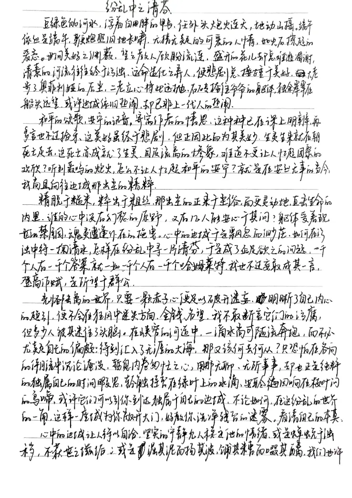

当时大概在读莎士比亚

* * *

# 纷乱中之清芬

豆绿色的河水，浮着白白胖胖的鸭。任外头炮火连天，地动山摇。端午依旧是端午，鞭炮照旧地长啸。无猜无疑的可爱的人情，如火石擦起的爱恋。世间美好之渊薮，教人顾盼流连。盛开的花儿却总难逃凋谢，清澈的河流往往终于污浊。运命造化之弄人，使悲剧总接踵于美好。大老步了奥菲利娅的后尘，二老立心将此远抛。石砖掩住爷爷的躯体，独余翠翠在船头远望。或许边城依旧热闹，却已非上一代人的热闹。

和平的颂歌，安宁的讯音，寄寓作者的情思。这种种已在课上明辨，再多言也不过拾牙。这美好虽终于悲剧，但正因此而为其美好。生灵生来就在朝死亡走去，这死亡亦成就了生灵。目及流离的惨象，难道不更让人忆起团聚的欢欣？听到轰鸣的炮火，怎不让人忆起和平的安宁？就是在安宁无事的如今，我尚且向往边城那出尘的精粹。

精脱于糙米，粹出于粗丝。那出尘的正来自于尘俗，而更灵动地直击生命的内里。谁的心中没有幻想的原野，又有几人能安心于其间？躯体受着现世的禁锢，魂灵遭逢外在的拖拽。心中的边城于是飘忽而渺茫。如何在污浊中得一掬清水，怎样在纷乱中寻一片清芬，于是成了企足欲之的。一千个人有一千个答案，就如一千个人有一千个哈姆莱特。我也不过妄敢成其一言：登高作赋，是所望于群公。

光怪陆离的世界，只要一颗赤子之心便足以破开迷妄。明明晰了自己内心的趋引，便不会在狂风中迷失方向。金钱、名望，我不愿断言它们的污腐，但多少人被其迷住了头脑。在狭窄的河道中，一滴水尚可随流奔跑，而不必犹疑自己的偏颇；待到汇入了无涯的大海，那又该何去何从？只恐怕在各向的潮流中沉沦淹没。何莫驻足，用那无聊、无所事事，却也正是纯粹的独属自己的时间暇思，轻触独留在绿叶上的水滴，安聆回响在枝叶间的鸟啼。或许它们可以引你到达独属于自己的边城。不论如何，在这纷乱的世界的一角，这样一座城为你敞开大门，好教你洗净残留的迷蒙，看清自己的本真。

心中的边城让人得以自洽。坚实的宁静允人稳定他的情绪，或是蝉蜕于浊秽，不获世之滋垢；或是汩其泥而扬其波，餔其糟而啜其醨。但是顺了心中的本真，大约总可觅得一隅安然。

敢竭鄙怀，恭疏短引。请洒潘江，各倾陆海云尔。

